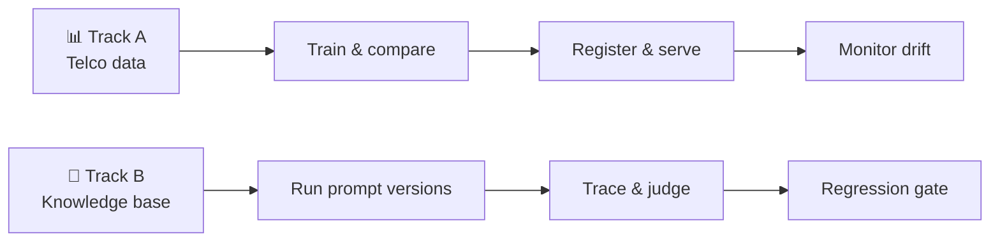

<div align="center">

# 🧪 MLOps Lab

**Two complete, independent MLOps workflows: a churn model and a tool using AI agent.**


[Explore Track A](track_a_churn/README.md) · [Explore Track B](track_b_agent/README.md) · [View saved results](#saved-results)

</div>

---

## 🧭 Choose a track

| | **Track A · Customer churn** | **Track B · Agent evaluation** |
| --- | --- | --- |
| **Goal** | Train, serve, and monitor a Telco churn classifier | Measure and improve a knowledge base agent across six prompt versions |
| **Core stack** | uv · scikit-learn/XGBoost · MLflow · FastAPI · Evidently | uv · Ollama · Qdrant in memory · MLflow · Evidently |
| **Saved result** | Logistic regression: **F1 0.6599**, ROC AUC 0.8614 | Best judge score: **10/14 (71.4%)**; below the 80% gate |
| **Start here** | [Track A guide →](track_a_churn/README.md) | [Track B guide →](track_b_agent/README.md) |



> [!NOTE]
> The tracks have separate `pyproject.toml`, `uv.lock`, tests, and local MLflow stores. Run commands from the track directory.

## 🚀 Quick start

### Track A · Train and monitor churn

```bash
cd track_a_churn
uv sync --frozen
uv run python src/run_pipeline.py
uv run pytest -q
```

The pipeline trains six candidates, compares them, registers the winner, and creates clean and synthetic drift reports. Start the optional interfaces after it finishes:

```bash
uv run mlflow ui --backend-store-uri sqlite:///mlflow.db
uv run uvicorn --app-dir src serve:app --port 8000
```

MLflow opens at `http://localhost:5000`. The API offers `/health`, `/model-info`, and `/predict`; see the [sample request](track_a_churn/sample_request.json) and [serving details](track_a_churn/README.md#serving).

### Track B · Evaluate the agent

Track B needs an OpenAI compatible chat endpoint. The checked in config uses Ollama with `gemma:latest`. Start it in one terminal:

```bash
ollama pull gemma:latest
ollama serve
```

Then, in another terminal:

```bash
cd track_b_agent
uv sync --frozen
uv run python src/run_queries.py --version v5 --limit 2
uv run python src/run_experiment.py --version v5
uv run python src/run_all_versions.py
uv run pytest -q
```

`run_queries.py` is a small smoke run; `run_experiment.py` creates one complete report; `run_all_versions.py` evaluates every configured version and compares the MLflow runs. A full run makes many local LLM calls. The [agent guide](track_b_agent/README.md) covers settings, API usage, and report files.

<a id="saved-results"></a>

## 📈 Saved results

| Evidence | What it shows |
| --- | --- |
| [Track A model comparison](track_a_churn/reports/run_comparison.md) | Six candidates on the held out test split; `logreg_C1.0` leads on F1 |
| [Track A registry transitions](track_a_churn/reports/registry_transitions.json) | Staging validation followed by Production promotion |
| [Track A drift reports](track_a_churn/reports/evidently/) | Clean and synthetic drift scenarios |
| [Track B versioned reports](track_b_agent/reports/runs/) | v1–v6 traces, harness scores, judge verdicts, and Evidently HTML |

**Track B's best saved judge result is v5 at 10/14 cases (71.4%).** The promotion gate is 80%, so none of the saved versions qualifies. The version comparison CSV, Markdown, and PNG are generated by `src/compare_versions.py`; they are not checked in.

## 🗂️ Repository map

```text
track_a_churn/
├── src/              data, training, registry, serving, monitoring
├── data/             Telco CSV and processed splits
├── dags/             optional Airflow drift workflow
├── reports/          comparisons and Evidently reports
└── tests/
track_b_agent/
├── app/              FastAPI assistant and RAG
├── agent/            tool loop, LLM client, search/weather/calculator
├── configs/          versioned experiment settings
├── prompts/          versioned instructions
├── data/kb/          sample knowledge base
├── eval/             fixed questions and golden responses
├── src/              experiment, judge, comparison, replay
├── dags/             optional Airflow regression DAG
├── frontend/         Streamlit chat UI
├── reports/runs/     saved version evidence
└── tests/
```

## ✅ Verification

On 19 October 2026, the existing project environments ran both unit suites: **Track A: 4 passed; Track B: 8 passed**. `uv run --frozen pytest -q` could not initialize the host's global uv cache due to access permissions, so verification used each track's `.venv/Scripts/python.exe -m pytest -q` directly. The tests do not exercise a live Ollama endpoint or Airflow scheduler; the saved experiment reports contain the earlier integration outputs.
