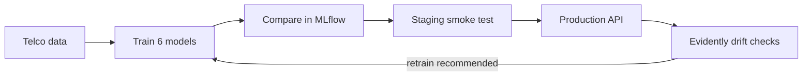
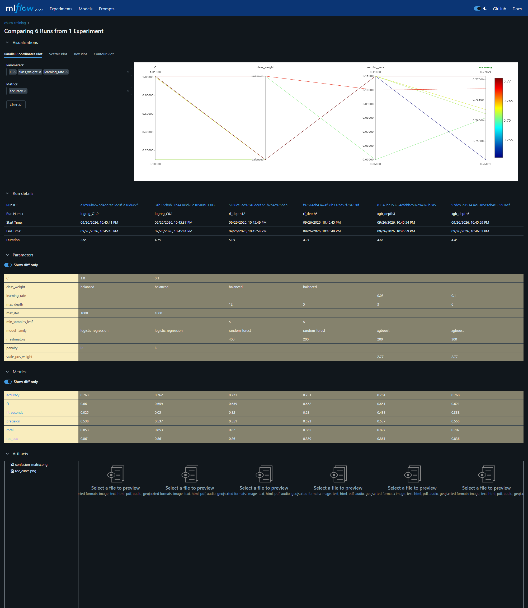
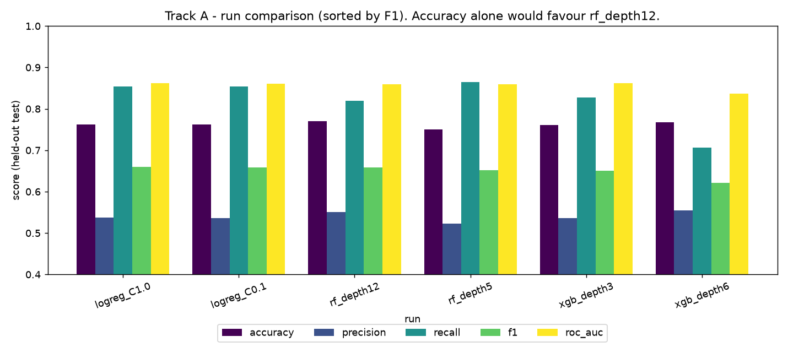
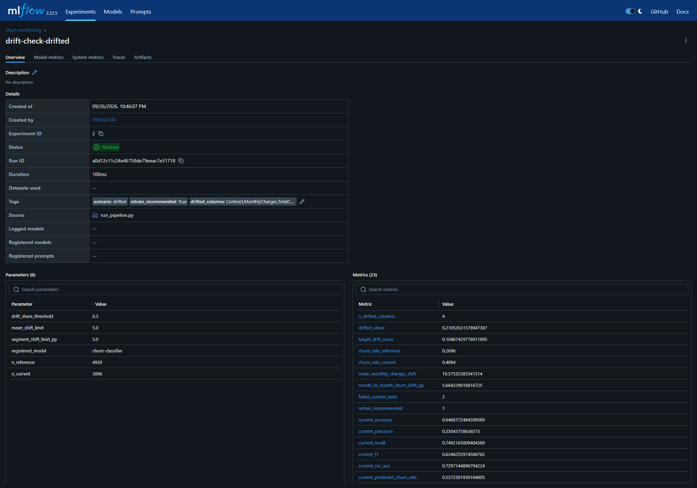

# 📉 Track A · Customer Churn MLOps

**Train six models. Promote the best one. Serve predictions. Detect drift before it goes unnoticed.**


[← Project overview](../README.md) · [Quick start](#quick-start) · [Experiments](#experiment-tracking) · [Drift](#monitoring-and-drift) · [Results](#deliverables-map)

The project uses the IBM Telco Customer Churn data: **7,043 customers**, with `Churn` as the target (26.5% positive). The CSV is committed; [`get_data.py`](src/get_data.py) can also download it from IBM's public GitHub mirror. The workflow combines **uv**, **MLflow**, **FastAPI**, **Evidently**, and an optional **Airflow** DAG.



| Data | Saved winner | Saved drift outcome |
| --- | --- | --- |
| 7,043 customers · 70/30 reference/current split | `logreg_C1.0` · F1 **0.6599** · ROC AUC **0.8614** | Clean: no retrain · Synthetic drift: retrain recommended |

## Quick start

```bash
cd track_a_churn
uv sync                                # creates .venv from the committed uv.lock
uv run python src/run_pipeline.py      # data -> train -> compare -> register -> monitor
```

That produces everything in `reports/` (see [Deliverables map](#deliverables-map)). Then, optionally:

```bash
uv run mlflow ui --backend-store-uri sqlite:///mlflow.db         # browse runs + registry at http://localhost:5000
uv run uvicorn --app-dir src serve:app --port 8000               # serve the Production model
curl -X POST localhost:8000/predict -H "Content-Type: application/json" -d @sample_request.json
uv run pytest -q                                                 # 4 tests for the split, drift injection, custom metrics
```

Individual steps: `src/train.py`, `src/compare.py`, `src/register.py`, `src/monitor.py` (`--scenario clean|drifted|both`).

## Repository layout

| Path | Purpose |
|---|---|
| `pyproject.toml`, `uv.lock` | dependencies (locked) |
| `src/common.py` | paths, feature lists, 70/30 split, preprocessing, MLflow setup |
| `src/train.py` | trains 6 models, logs params/metrics/artifacts to MLflow |
| `src/compare.py` | exports the side-by-side run comparison (CSV/Markdown/PNG) |
| `src/register.py` | registers the best run, Staging -> smoke test -> Production |
| `src/serve.py` | FastAPI app loading `models:/churn-classifier/Production` |
| `src/drift.py`, `src/custom_metrics.py`, `src/monitor.py` | drift injection, custom Evidently metrics, monitoring + retrain policy |
| `dags/churn_drift_dag.py` | Airflow DAG (bonus) |
| `tests/` | pytest suite |
| `reports/` | run comparison, registry log, Evidently HTML reports, MLflow screenshots |

---

## Environment and reproducibility

Problems uv solved **in this project** (all hit while building it):

1. **Transitive-dependency clash.** With an unconstrained resolve, `sqlalchemy` 2.1.1 was installed, and MLflow 2.22's
   tracking store crashed on import (`ImportError: cannot import name 'FallbackAsyncAdaptedQueuePool'`). The fix is a
   one-line constraint (`sqlalchemy>=2.0,<2.1`) recorded in `pyproject.toml`, and the *resolved* set is frozen in `uv.lock`,
   so nobody else can land on the broken combination.
2. **Deliberate major-version pins.** `mlflow<3` because the assignment requires Model Registry *stages*
   (Staging -> Production), which MLflow 3 dropped in favour of aliases; `evidently>=0.7,<0.8` because 0.7's
   `Report`/`Dataset`/`SingleValueMetric` API is incompatible with the 0.4-0.6 API used by most online examples.
3. **Python version.** `requires-python = ">=3.12,<3.13"` plus `.python-version`; uv fetches the interpreter if missing.
4. **Wheel-heavy stack** (numpy 2.x, scikit-learn 1.9, xgboost 3.x, pandas): one lock file guarantees the same binaries everywhere.

**One-command reproduction:** `uv sync && uv run python src/run_pipeline.py`.
The committed CSV and lock file provide the inputs for a fresh run. See [Verification](#verification) for the checks performed in this workspace.

---

## Experiment tracking

**Setup.** Reference data (random 70%, 4,930 rows) is what the model trains on; it is split again 80/20 stratified into
train (3,944) and held-out test (986). The remaining 30% ("current") is never used for training. Store: SQLite
(`mlflow.db`; required for the registry), experiment `churn-training`.

**What I varied (hyperparameters genuinely differ across runs, not just the seed):**

| Run | Family | Varied hyperparameters |
|---|---|---|
| `logreg_C0.1` / `logreg_C1.0` | Logistic regression | `C` 0.1 vs 1.0 (L2 penalty) |
| `rf_depth5` / `rf_depth12` | Random forest | `max_depth` 5 vs 12, `n_estimators` 200 vs 400 |
| `xgb_depth3` / `xgb_depth6` | XGBoost | `max_depth` 3 vs 6, `learning_rate` 0.05 vs 0.1, `n_estimators` 200 vs 300 |

Class imbalance is handled with `class_weight="balanced"` (logreg, RF) and `scale_pos_weight=2.77` (XGBoost).

**What each run logs:** all hyperparameters; accuracy, precision, recall, F1, ROC-AUC (threshold 0.5) and `fit_seconds`;
artifacts `confusion_matrix.png`, `roc_curve.png` and the full sklearn `Pipeline` (preprocessing + model) with signature and input example.

### Side-by-side comparison (all 6 runs, held-out test set, sorted by F1)

| run         | accuracy | precision | recall | **F1** | **ROC-AUC** | fit_seconds |
|:------------|---------:|----------:|-------:|-------:|------------:|------------:|
| **logreg_C1.0** | 0.7627 | 0.5379 | 0.8534 | **0.6599** | **0.8614** | 0.03 |
| logreg_C0.1 | 0.7617 | 0.5366 | 0.8534 | 0.6589 | 0.8608 | 0.06 |
| rf_depth12  | **0.7708** | 0.5505 | 0.8195 | 0.6586 | 0.8598 | 0.52 |
| rf_depth5   | 0.7505 | 0.5227 | 0.8647 | 0.6516 | 0.8589 | 0.28 |
| xgb_depth3  | 0.7606 | 0.5366 | 0.8271 | 0.6509 | 0.8615 | 0.33 |
| xgb_depth6  | 0.7677 | 0.5546 | 0.7068 | 0.6215 | 0.8362 | 0.36 |

(Also: `reports/run_comparison.md|csv|png`, and the MLflow UI compare view below.)




### Which model I registered, and why

**`logreg_C1.0` (F1 0.660, ROC-AUC 0.861, recall 0.853) was registered as `churn-classifier` v1.**

* **Selection metric = F1 (ROC-AUC as tie-break), not accuracy.** Only 26.5% of customers churn, so accuracy rewards
  models that under-predict churn. That is visible here: `rf_depth12` has the *highest accuracy* (0.771) but that comes from
  higher precision and *lower* recall (0.820 vs 0.853) - it misses more churners than `logreg_C1.0`, and its F1 (0.659) and
  ROC-AUC (0.860) are not better.
* **XGBoost depth 6 is clearly worst**: recall collapses to 0.707 and AUC to 0.836 - it overfits with `max_depth=6, lr=0.1`.
* **The honest caveat: the top four are statistically indistinguishable.** F1 spans 0.651-0.660 and AUC 0.859-0.862 on a
  986-row test set (a difference of ~0.01 F1 is well within sampling noise). The numbers make `logreg_C1.0` the winner,
  but the *deciding* argument is the trade-off: it ties or beats every model on F1/AUC while being the **simplest,
  fastest (0.03 s fit), most interpretable** model, and it has the highest recall - the metric that matters most for a churn
  campaign, where a missed churner is costlier than a wasted retention offer. I would not claim tree ensembles are worse
  in general; on this small tabular dataset they simply do not add anything.
* Trade-off: recall 0.85 comes with precision 0.54 (about half of flagged customers won't churn). A higher decision
  threshold would trade recall for precision; the threshold is a business choice and is left at 0.5.

### Model Registry stage transitions

`src/register.py` (log: `reports/registry_transitions.json`):

1. `mlflow.register_model` -> `churn-classifier` **v1** (source run `logreg_C1.0`, description with F1/AUC).
2. Transition **None -> Staging**.
3. **Validation gate**: load `models:/churn-classifier/Staging` back from the registry and score 50 real rows;
   assert 50 probabilities in [0, 1].
4. Transition **Staging -> Production** (`archive_existing_versions=True`, so a retrained v2 automatically archives v1).

Final state: `churn-classifier v1 = Production`.

### Serving

`src/serve.py` is a thin FastAPI wrapper that loads `models:/churn-classifier/Production` on startup
(`GET /health`, `GET /model-info`, `POST /predict` with pydantic-validated customer records; invalid input -> HTTP 422).
Tested response for `sample_request.json`:

```json
{"model":{"model_uri":"models:/churn-classifier/Production","version":1,"source_run":"logreg_C1.0"},
 "predictions":[{"churn_probability":0.8415,"churn":true},{"churn_probability":0.151,"churn":false}]}
```

MLflow's built-in alternative also works: `mlflow models serve -m models:/churn-classifier/Production -p 5001 --env-manager local`.

---

## Monitoring and drift

**Reference vs current.** *Reference* = the 70% random sample the model was trained on ("training-time" data, 4,930 rows).
*Current* = the other 30% (2,113 rows) standing in for incoming production data. Two scenarios are run against the reference:

* **`clean`** - the 30% split untouched (a control: a monitoring setup that cries wolf on healthy data is useless).
* **`drifted`** - the same split after `src/drift.py` injects four perturbations:
  1. `MonthlyCharges` + random per-row offset ~ N(20, 8);
  2. `tenure` - random 0-18 months;
  3. `Contract`: month-to-month over-sampled from ~55% to ~75% of rows;
  4. label drift: 12% of `Churn=No` flipped to `Yes`.

**What is monitored** (3 HTML reports per scenario in `reports/evidently/`, also logged as MLflow artifacts to experiment `churn-monitoring`):

* **Data drift** (`DataDriftPreset`, per-column Wasserstein/Jensen-Shannon, threshold 0.1) -> `*_data_drift.html`
* **Target drift** (`ValueDrift` on `Churn`) -> `*_target_drift.html`
* **Custom metrics** defined with Evidently's `SingleValueMetric` API (`src/custom_metrics.py`) + pass/fail tests -> `*_custom_metrics.html`:
  * `MeanShift(MonthlyCharges)` - current minus reference mean bill, **test: must be < $5**
  * `SegmentRateShift(Contract=Month-to-month, Churn=Yes)` - churn-rate shift in that segment in percentage points, **test: must be < 5 pp**

### What the reports showed

| | clean | drifted |
|---|---|---|
| Drifted columns | none (0 / 19) | `tenure`, `MonthlyCharges`, `Contract`, `TotalCharges` (4 / 19 = 21%) |
| Injected columns detected | - | **all 3** (`MonthlyCharges` 0.65, `tenure` 0.52, `Contract` 0.146 vs threshold 0.1) |
| Target drift (Churn) | no (score 0.011; churn 27.0% -> 25.6%) | **yes** (score 0.105; churn 27.0% -> 40.9%) |
| Mean `MonthlyCharges` shift | -$0.39 | **+$19.58** (test FAIL, limit $5) |
| Month-to-month churn-rate shift | -1.9 pp | **+5.7 pp** (test FAIL, limit 5 pp) |
| Model ROC-AUC, reference hold-out -> current | 0.861 -> 0.833 | 0.861 -> **0.730** |
| Model accuracy | 0.763 -> 0.738 | 0.763 -> **0.647** |
| Model's predicted churn rate | 42.8% -> 39.9% | 42.8% -> **55.7%** |
| Retrain recommended | no | **yes** |

Interpretation:

* **The engineered drift was detected correctly** - every perturbed column was flagged, and no un-perturbed feature was
  flagged except **`TotalCharges`**, which I never touched: it is a spill-over (lifetime charges = tenure x monthly bill, and
  month-to-month customers have lower lifetime charges), i.e. a *true* consequence of the change, not a false positive.
* **Drifted share (21%) alone would NOT have triggered retraining** (policy threshold is 30%). It was the target-drift check and the
  custom business-metric tests that caught it. That is the reason to have more than the default preset.
* **Impact on the model if this happened in production:** the model was trained on customers with higher tenure and lower bills, so
  on the drifted population its ROC-AUC drops from 0.86 to 0.73 and it flags 56% of customers as churners (vs 43%) - the retention
  team would be flooded with false alarms. Caveat: the label flip is synthetic and partly randomises the "truth", so the
  AUC/accuracy drop is a stress test rather than a forecast; the *label-free* signals (feature drift, predicted-churn-rate
  jump) are the ones you would actually have in production before labels arrive.
* The clean run has a natural AUC dip (0.861 -> 0.833) with **zero** drift flagged; that is ordinary sampling variation between
  two random splits, and a reminder that a small performance change alone is not proof of drift.

### Action on drift (policy in `monitor.py`)

`retrain_recommended = True` if **any** of: >= 30% of feature columns drifted; the target drifted; any custom test fails.
On a positive signal: (1) log the recommendation + reasons to the MLflow run tags and `reports/evidently/*_summary.json`;
(2) retrain all candidates (`train.py`) on fresh labelled data, compare, and let `register.py` push the winner
Staging -> smoke test -> Production, archiving the old version. The Airflow DAG below automates this; a human can also
gate step 2 (see the `churn_auto_retrain` variable).



---

## Orchestration

`dags/churn_drift_dag.py`, DAG `churn_drift_monitoring`:

```
check_drift --> decide --+--> retrain_model --> promote_model
                         +--> no_action
```

* **Schedule:** `@daily` (edit `schedule=` for weekly/monthly), `catchup=False`, 1 retry.
* **Trigger condition:** `monitor.run_drift_check()` returns `retrain_recommended` (policy above).
* **On a positive signal:** `retrain_model` (`train.main()` + comparison export) then `promote_model` (`register.main()`).
  If the Airflow Variable `churn_auto_retrain` is `false`, the branch only prints a *recommendation* and goes to `no_action`.
* **Status - please read:** the DAG file compiles and every function it calls is exercised by the pipeline/tests, but I could **not run it inside
  a real Airflow instance**: Airflow does not run natively on Windows and Docker is not installed on this machine. To run it:
  `pip install "apache-airflow>=2.9"` on Linux/WSL2/Docker, set `AIRFLOW__CORE__DAGS_FOLDER` to `dags/`, and export `CHURN_PROJECT_DIR`.
  In the demo the "incoming batch" is the 30% split with synthetic drift; a real deployment would read logged production requests
  in `check_drift`.

---

## Deliverables map

| Assignment deliverable | Where |
|---|---|
| uv: `pyproject.toml` + committed `uv.lock` | `pyproject.toml`, `uv.lock` |
| MLflow run comparison for all >=3 models | table above, `reports/run_comparison.{md,csv,png}`, `reports/screenshots/mlflow_compare_runs.png` |
| Registry stage transitions | `reports/registry_transitions.json`, [Model Registry stage transitions](#model-registry-stage-transitions) |
| Evidently HTML reports | `reports/evidently/*.html` (also MLflow artifacts under `churn-monitoring`) |
| Airflow DAG (bonus) | `dags/churn_drift_dag.py` |
| Serving | `src/serve.py` |
| README | this file |

## Verification

The existing project environment ran `python -m pytest -q` on 19 October 2026: **4 passed**. The tests cover the data split, drift injection, and custom monitoring metrics. A fresh environment install and full pipeline rerun were not part of this check; the committed [reports](reports/) contain the earlier pipeline outputs.

## Limitations

* No hyperparameter search or cross-validation: 6 hand-picked configs, one held-out split (selection on the test split is slightly optimistic).
* The drift is synthetic; the numbers show that the machinery works, not what real drift looks like.
* Registry *stages* are deprecated upstream (hence the MLflow 2.x pin); a future migration should use aliases.
