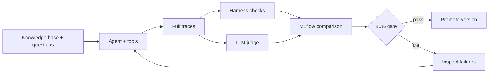

# 🤖 Track B · Agent MLOps

**Trace every tool call. Judge every answer. Promote a prompt only when it clears the regression gate.**


[← Project overview](../README.md) · [Setup](#prerequisites-and-setup) · [Run experiments](#run-experiments) · [Saved results](#saved-results-by-version) · [API](#serve-the-assistant)

Six prompt/config versions answer the same **14 Nimbus Cloud questions**. The pipeline captures full traces, checks answers and tool choice with a deterministic harness, judges correctness and grounding with Evidently, and logs prompts, parameters, metrics, and reports to MLflow.



| Agent tools | Retrieval | Saved best result |
| --- | --- | --- |
| Document search · mock weather · calculator | Sentence transformers + Qdrant in memory | v5: **10/14 judge cases (71.4%)**; no version clears the 80% gate |

The evaluation needs a chat model for agent answers and the separate LLM judge. The document search index runs in memory, so it does not require a Qdrant server.

## Prerequisites and setup

- Python 3.12 and uv.
- A running Ollama server with `gemma:latest`, as configured in [versions.yaml](configs/versions.yaml). The default agent URL is `http://localhost:11434/v1`; the Evidently judge uses `http://localhost:11434`.
- Network access may be needed the first time `all-MiniLM-L6-v2` is downloaded by sentence-transformers.

```bash
ollama pull gemma:latest
ollama serve
```

In a second terminal, from `track_b_agent/`:

```bash
uv sync --frozen
uv run python src/run_queries.py --version v5 --limit 2
uv run pytest -q
```

The first command installs from the committed lock file. The two-query run checks the agent and retrieval path without running the judge. The unit tests use fake LLM and tool responses; they do not require Ollama.

## Run experiments

```bash
# One complete version: agent + harness + judge + Evidently + MLflow
uv run python src/run_experiment.py --version v5

# Every configured version, followed by comparison and promotion check
uv run python src/run_all_versions.py

# A selected subset
uv run python src/run_all_versions.py v5 v6

# Compare runs already present in the local MLflow database
uv run python src/compare_versions.py

# Rejudge saved traces after changing judge settings or prompts
uv run python src/rejudge.py --version v5
```

All commands use the current directory's `mlflow.db` and `mlartifacts/`. A full run generates:

| Output | Purpose |
| --- | --- |
| `reports/runs/<version>/traces.jsonl` | One full step trace per question, including tool observations, parsing errors, tokens, latency, and termination reason |
| `reports/runs/<version>/harness_per_query.csv` | Deterministic answer, tool use, and termination scores |
| `reports/runs/<version>/judge_verdicts_<version>.csv` | Correctness and grounding verdicts against the golden response |
| `reports/runs/<version>/evidently_regression_<version>.html` | Regression checks and suite threshold |
| `reports/runs/<version>/representative_traces/` | Selected success and failure examples |
| `reports/version_comparison.{csv,md,png}` | Generated by `compare_versions.py` after MLflow runs exist |

Browse MLflow with:

```bash
uv run mlflow ui --backend-store-uri sqlite:///mlflow.db
```

Open `http://localhost:5000` and select the `agent-prompt-versions` experiment.

### What is measured

The deterministic harness checks required answer facts, expected tool calls, and successful loop termination. It aggregates task success, tool selection accuracy, parse error rate, iterations, token usage, and latency. The Evidently regression suite compares each response with [golden responses](eval/golden_responses.json), using an LLM judge for **correctness** and **grounding**. A case passes only when both checks pass. A missing answer fails even when the reference is a refusal.

The promotion gate requires at least **80%** of cases to pass both judge checks. Among qualifying runs, `compare_versions.py` ranks by judge pass rate, then harness task success, then lower average tokens. It tags the winning MLflow run as promoted. If no run qualifies, no version is promoted.

### Saved results by version

The following counts come from the checked in per-query CSVs; each version answered the same 14 questions.

| Version | Harness successes | Judge cases passed | Judge pass rate | Gate |
| --- | ---: | ---: | ---: | --- |
| v1 | 0 | 0 | 0.0% | Fail |
| v2 | 8 | 7 | 50.0% | Fail |
| v3 | 8 | 9 | 64.3% | Fail |
| v4 | 7 | 9 | 64.3% | Fail |
| **v5** | **10** | **10** | **71.4%** | **Fail** |
| v6 | 7 | 8 | 57.1% | Fail |

> [!IMPORTANT]
> v5 is the strongest saved run, but it does **not** clear the 80% gate. No saved version qualifies for promotion.

The saved reports are in [reports/runs](reports/runs/). Prompt changes and their trace based rationale are in [versions.yaml](configs/versions.yaml). Judge outcomes depend on the configured local model and may vary on a fresh run.

## Serve the assistant

The FastAPI app has the earlier document ingestion and chat endpoints plus the evaluated agent endpoint:

| Endpoint | Behavior |
| --- | --- |
| `GET /health` | Health and configured provider |
| `POST /ingest` | Chunk and index `document_text` in the process's in-memory vector store |
| `POST /chat` | Chat with optional RAG through `user_query` and `use_rag` |
| `POST /agent` | Run a selected prompt version with `question` and `version`; return answer and trace |

From this directory, with Ollama available:

```bash
uv run uvicorn app.main:app --port 8000
curl -X POST http://localhost:8000/agent -H "Content-Type: application/json" -d '{"question":"What does the Pro plan cost?","version":"v5"}'
```

The `/agent` endpoint builds the included Markdown knowledge base in memory when a version is first used. `/chat` uses the separately ingested in-memory collection; ingest documents before asking it document specific questions. In-memory indexes are lost on restart. The `/agent` endpoint defaults to **v3** when `version` is omitted; specify a version explicitly if needed.

The optional Docker Compose stack starts backend, Streamlit frontend, and Redis:

```bash
docker compose up --build
```

Run this from `track_b_agent/`. The frontend is at `http://localhost:8501` and calls `/chat`, not `/agent`. The backend default Compose endpoint is `http://host.docker.internal:11434/v1`, so the container must be able to reach the Ollama host. The vector store itself runs in memory; Compose's Redis service supports the earlier app's cache module.

## Configuration and project layout

- [configs/versions.yaml](configs/versions.yaml): model and prompt per version, retrieval `top_k`, chunk size, loop limit, parser mode, and rationale.
- [prompts/](prompts/): versioned agent instructions.
- [data/kb/](data/kb/): six local Nimbus Cloud Markdown documents searched by the agent.
- [eval/](eval/): fixed questions, expected facts/tools, and approved reference answers.
- [agent/](agent/): LLM client, JSON tool loop, search/weather/calculator dispatch.
- [src/](src/): evaluation runner, deterministic harness, Evidently judge, MLflow comparison, and rejudge script.
- [app/config.py](app/config.py): runtime settings, overridable through environment variables or a local `.env` file. `LLM_API_BASE` and `LLM_API_KEY` configure the agent; `JUDGE_PROVIDER`, `JUDGE_MODEL`, and `JUDGE_API_URL` configure the regression judge.
- [dags/agent_regression_dag.py](dags/agent_regression_dag.py): optional Airflow nightly regression DAG. It uses `agent_prompt_version` (default **v3**) and fails the alert branch when the pass rate falls below its threshold or task success drops beyond the configured baseline. Airflow is not included in this track's locked dependencies.

## Verification and limits

The existing local environment ran `python -m pytest -q` on 19 October 2026: **8 passed**. The tests cover parser behavior, the agent loop, calculator safety, and harness scoring. They do not exercise the live Ollama judge, FastAPI service, Docker stack, or Airflow scheduler. The saved HTML and CSV reports provide evidence from earlier end to end experiment runs.

The knowledge base and weather result are demonstration data. Small local LLM judgments can vary, so the saved percentages are a record of these runs, not a guaranteed result for a new model or prompt configuration.
